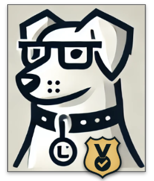

# LASSI-Verify



> **Status:** This repository is being prepared for public release and is pending institutional open-source clearance. (Remove this line once cleared.)

## What is LASSI-Verify?

LASSI-Verify is an adaptive empirical verification framework for parallel scientific GPU code transformations. Its goal is to determine whether an LLM-generated refactoring of a CUDA kernel (optimized for energy efficiency or runtime) is functionally equivalent to the original source and genuinely better-performing. The framework is adaptive in that verification properties are drawn from structured catalogs and instantiated relative to each specific transformation, while the three-tier architecture and mandatory coverage requirements remain fixed.
It wraps around a multi-iteration LLM self-improvement loop ("LASSI") with three formal-methods-grounded verification tiers that together provide correctness evidence without requiring formal proofs or exhaustive testing.

## How It Works

LASSI-Verify treats the source kernel's observable behavior as its specification and grounds acceptance of each LLM-generated variant in three tiers, all mandatory and none individually sufficient:

1. **Tier 1 — Invariant assertions.** LLM-proposed, catalog-grounded runtime assertions over program state, inserted into both source and variant.
2. **Tier 2 — Observational equivalence.** Empirical comparison of output state between source and variant under matched execution.
3. **Tier 3 — Metamorphic relations.** Property-based checks that must hold across systematically perturbed executions of the variant.

A **witness chain** — a seeded, cheat-resistant instrumentation mechanism — supplies launch-integrity evidence for benchmark-structured (timed-loop) code, added after observing LLMs delete timed work to fabricate speedups. Every tier failure doubles as a repair signal fed back into the next LLM self-correction attempt. An LLM-as-judge verdict is also recorded for comparison, but never contributes to the framework's own accept/reject decision.

See the paper for the full design and preliminary results (citation below).

## Repository Layout

- `run_lassi.py` — CLI entry point for running the pipeline (config via `config.yaml`)
- `lassiapp.py` — Streamlit GUI launcher
- `lassi/` — core package: `pipeline_v4.py` (orchestration), `verify.py` (Tier 1/2/3 instrumentation + witness chain), `prompt_dictionary.py` (LLM prompts), `context/` (property catalogs)
- `source_codes/HeCBench/` — the vendored CUDA kernels used in the reported experiment (see `source_apps.json` for per-kernel build parameters)
- `lassi_verify_analysis/` — post-hoc analysis package that computes the paper's tables/figures from raw per-trial logs
- `scripts/` — standalone utility/validation scripts
- `AGENTS.md` — background and architecture notes for AI coding assistants working in this repo; a good starting point if you're using one to help set up or run the pipeline

## Benchmark Kernels

The 16 HeCBench kernels used in the reported experiment (exec params are the positional
arguments passed to each benchmark binary, from `source_apps.json`):

| Kernel | Lines of Code | Exec Params |
|---|---|---|
| all-pairs-distance | 328 | `10000` |
| atomicCost | 10 | `16 10` |
| bsearch | 279 | `8388608 100` |
| chacha20 | 130 | `300000` |
| colorwheel | 154 | `10000 256 500000` |
| entropy | 171 | `10000 1024 1` |
| extrema | 349 | `750` |
| floydwarshall | 295 | `2048 100 16` |
| jaccard | 417 | `1024 512 1000` |
| layout | 197 | `2500` |
| lid-driven-cavity | 1079 | (none) |
| murmurhash3 | 245 | `750000 500` |
| pathfinder | 286 | `100000 10000 2500` |
| randomaccess | 158 | `10` |
| segment-reduce | 95 | `16384 100` |
| threadfence | 139 | `100 250000000` |

## Getting Started

```bash
# Create and activate a virtual environment
python3 -m venv .venv
source .venv/bin/activate

# Install dependencies
pip install -r requirements.txt

# Copy the config template (config.yaml itself is gitignored; it's your
# per-experiment working file)
cp config.yaml.example config.yaml
```

A Linux system with a CUDA-capable NVIDIA GPU and `nvcc` on `PATH` is required. The pipeline is not pinned to a specific architecture beyond the `-arch` flag passed to `nvcc` (set in `config.yaml`); the reported experiment used an NVIDIA RTX 5000 Ada (`sm_89`).

### LLM Backend Setup

LASSI-Verify's `llm.backend` config field selects which LLM backend the pipeline calls. Two options are supported:

| Backend | Who can use it | Required config |
|---|---|---|
| `ollama` | Anyone running a local [Ollama](https://ollama.com) server | None — connects to `localhost:11434` by default; make sure the chosen model has been pulled (`ollama pull <model>`) |
| `openai_compatible` | Anyone — works with OpenAI itself, an institutional LLM gateway that exposes an OpenAI-compatible endpoint, or any self-hosted server implementing the same REST contract (vLLM, llama.cpp server, LM Studio, OpenRouter, etc.) | `llm.openai_compatible.base_url` and an API key (either `llm.openai_compatible.api_key` in `config.yaml`, or the `OPENAI_API_KEY` environment variable) |

See `config.yaml.example` for the full field layout, and `lassiapp.py`'s GUI for an interactive way to configure this — for `openai_compatible`, the GUI's model dropdowns are populated dynamically from the endpoint's `/models` list rather than typed by hand.

### Run via the CLI

```bash
python run_lassi.py
```

Experiment configuration (kernel selection, LLM backend/model, verification tier toggles, trial count, etc.) is read from `config.yaml` on every run.

### Run via the GUI

```bash
streamlit run lassiapp.py
```

Opens a browser-based form at `http://localhost:8501` for configuring and launching a run without editing `config.yaml` directly.

## Adding a New Kernel

Trying a new HeCBench kernel doesn't require any code changes — it just needs to be vendored into `source_codes/HeCBench/` and registered in `source_apps.json`:

1. **Vendor the source file(s).** HeCBench's own repo nests kernels as `src/<kernel>-cuda/main.cu`; this pipeline expects a flat layout instead: `source_codes/HeCBench/<kernel>/<kernel>-cuda_main.cu` (and `<kernel>-hip_main.cu` if you also want an AMD/HIP path). Copy the kernel's source in and rename its main file to match this convention.
2. **Local headers just work.** If the kernel `#include`s a local header (e.g. `#include "kernels.h"`), put the header in the same flat kernel folder with a plain relative include — no path prefix needed. `code_manager.py` passes an `-I` flag pointing at the kernel's own source folder on every compile, so the header resolves correctly no matter where the pipeline writes the generated/instrumented copy.
3. **Register it in `source_apps.json`**, under `"HeCBench"`, with:
   - `app_folder` — the kernel's folder name (must match step 1)
   - `app_params` — the benchmark's positional command-line arguments (check the kernel's own `argv` parsing or README to get these right)
   - `code_lines` — informational only; shown in the GUI's kernel picker
4. That's it — `lassiapp.py`'s kernel dropdown reads directly from `source_apps.json`, so the new kernel shows up automatically. No changes needed anywhere in `lassi/`.

One thing you can't set up in advance: whether Tier 3 finds a usable metamorphic relation for the kernel is decided by the LLM at runtime (Stage 0's source filter) — some computational patterns are easier for the LLM to find a relation for than others, and this only surfaces once you actually try the kernel.

## Related Projects

LASSI-Verify is part of a small suite of tools from the same research group exploring LLM-based automated refactoring of parallel scientific GPU/HPC code:

- **LASSI** — the original self-correcting pipeline for translating parallel scientific code between languages (e.g., CUDA to OpenMP) via an iterative LLM self-correction loop. LASSI-Verify's self-correction loop builds directly on this design.
- **LASSI-EE** — re-targets the same self-correction loop at energy-efficiency refactoring, using runtime GPU power profiling and an LLM-as-judge screening step.
- **LASSI-Verify** (this repository) — replaces human review / LLM-judge screening with a three-tier empirical verification framework plus a witness chain for cheat-resistant loop-deletion detection.

See the Citation section below for references to all three.

## Citation

If you use LASSI-Verify in your research, please cite:

> M. T. Dearing, X. Wu, V. Taylor, and Z. Lan, "LASSI-Verify: Adaptive Empirical Verification of LLM-Generated Parallel Scientific Code Transformations," in *SC26 Workshops (Correctness 2026)*, Chicago, IL, USA, Nov. 2026.

See [`CITATION.cff`](CITATION.cff) for a machine-readable version.

### Related Publications

> M. T. Dearing, Y. Tao, X. Wu, Z. Lan, and V. Taylor, "LASSI: An LLM-based Automated Self-Correcting Pipeline for Translating Parallel Scientific Codes," in *International Workshop on Large Language Models and HPC (LLMxHPC), IEEE International Conference on Cluster Computing (CLUSTER)*, 2024. DOI: [10.1109/CLUSTERWorkshops61563.2024.00029](https://doi.org/10.1109/CLUSTERWorkshops61563.2024.00029)

> [Author list TBD], "LASSI-EE: LLM-based Automated Refactoring of Parallel Scientific Codes for Energy Efficiency," in *IEEE International Conference on Cluster Computing (CLUSTER) 2026 Workshops* (accepted).

## License

TBD, pending institutional review.
